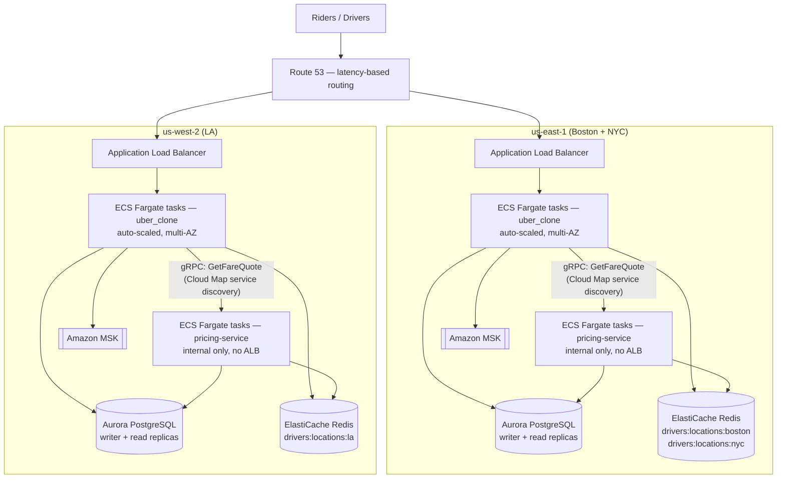

# Uber Clone — Kotlin Backend

A ride-hailing backend built with Kotlin and Spring Boot, split into two services. This app (`uber_clone`) handles the core Uber flow — riders request trips, drivers come online and accept them, dispatch and matching happen async over Kafka/Redis, and both sides can rate each other after completion. Fare/surge quoting is split out into [`pricing-service`](pricing-service/), called synchronously over gRPC — see [Services](#services) below for why.

## Services

This is two independently-run services, on purpose — everything downstream of a ride request (dispatch, matching, notifications) is async over Kafka/SSE and can tolerate eventual consistency, but a rider needs a fare *before* they'll confirm a ride. That one synchronous, must-answer-now step is what [`pricing-service`](pricing-service/) exists to isolate, called over gRPC:

```
Client → POST /rides → RideService --[gRPC: GetFareQuote]--> pricing-service
                            ↓ (fare returned, ride persisted)
                        Kafka "ride-requested" → async dispatch (unchanged)
```

`pricing-service` reads the same local Postgres and Redis as this app rather than replicating driver/ride state via events — see [`pricing-service/README.md`](pricing-service/README.md) for why that's a reasonable simplification for a local practice project but not something you'd do between real production services (it couples their schemas). Run it alongside this app on port `6565`; `RideService.calculateFare` will fail if it isn't running.

## Stack

| Layer | Technology |
|---|---|
| Language | Kotlin 2.2 / JVM 21 |
| Framework | Spring Boot 3.4 |
| Database | PostgreSQL (Spring Data JPA) |
| Cache | Redis (Spring Data Redis) |
| Messaging | Kafka (Spring Kafka) |
| Auth | JWT (JJWT 0.12) via HttpOnly cookies |
| Migrations | Flyway |
| Build | Gradle (Kotlin DSL) |

## Features

**Dispatch** — when a rider requests a trip, the ride is saved and a Kafka event is published immediately so `POST /rides` returns fast. A Kafka consumer picks up the event asynchronously, finds all online drivers within 5 km using a Redis geo-index, and publishes a ride offer to each driver's Redis pub/sub channel (`ride_offers:{driverId}`), including the driver's ETA to the rider. Drivers receive offers in real time over a persistent SSE connection (`GET /driver/offers`). The first driver to call `POST /rides/{id}/accept` gets the ride; concurrent accepts are handled safely with JPA optimistic locking. A scheduled job re-publishes any ride still stuck in `REQUESTED` after 2 minutes, so a dropped Kafka message or dispatch to zero available drivers doesn't strand a rider.

**Rides** — rides move through a status machine: `REQUESTED → MATCHED → IN_PROGRESS → COMPLETED` (or `CANCELLED`). Fare is quoted once at request time via a synchronous gRPC call to `pricing-service` (Haversine distance plus the current surge multiplier) and locked in — the rider pays that price regardless of surge changes during the trip. Riders get a live ETA to pickup once a driver accepts, then a live ETA to the destination once the trip starts, both recalculated as the driver's GPS location updates.

**Surge pricing** — owned by `pricing-service`. Redis-backed surge multiplier keyed by geographic area, scaling with local demand (nearby available drivers vs. nearby pending ride requests) and cached with a TTL.

**Driver management** — drivers register with vehicle details, toggle online/offline status, update their GPS location, and can query for nearby online drivers within a configurable radius. Online drivers are tracked in a Redis geo-index for proximity queries and a Redis Set (`drivers:available`) for O(1) availability checks — no Postgres table scans on dispatch.

**Ratings** — after a ride completes, riders and drivers can rate each other. Average ratings are stored on the driver profile.

**Auth & roles** — register, login, and `/auth/me`. JWTs are issued as HttpOnly cookies and carry a `role` claim (`RIDER` or `DRIVER`). All users start as `RIDER`. Calling `POST /driver/register` permanently upgrades the DB role to `DRIVER` and reissues the cookie. Drivers can toggle between modes with `POST /auth/switch-mode` — this only changes the active JWT claim, not the DB role. `@PreAuthorize` guards ensure riders can't call driver endpoints and vice versa. Passwords are BCrypt-hashed.

**Kafka events** — `ride-requested` triggers async dispatch; `ride-accepted`, `ride-completed`, and `ride-cancelled` are consumed for downstream work (payment processing, analytics) and to close the rider's live location stream.

**Rate limiting** — Redis-backed token buckets (Bucket4j) cap ride requests to 5/minute per rider and login/register attempts to 10/15 minutes per IP, so a retry loop or brute-force attempt can't hammer the API or the DB.

## Deployment architecture (AWS)

Ride matching is inherently local — a driver in LA never matches a rider in Boston — so the deployment is split by region rather than run as one global stack. Each region is fully self-contained (its own compute, Postgres, Redis, and Kafka), which gives both lower latency for the region it serves and fault isolation: an outage in one region doesn't affect the other.

**Capacity assumptions (back-of-envelope, for sizing purposes):**
- Scope: three cities — **Boston, New York, and LA** — grouped by coast: NYC + Boston in `us-east-1`, LA in `us-west-2`, since LA is ~2,500 miles / 60-80ms round-trip from the East Coast and ride matching has no cross-city dependency.
- Peak concurrent online drivers, anchored to a real reference point rather than a raw guess: NYC's Taxi & Limousine Commission capped for-hire vehicle licenses at roughly **100,000 vehicles** (2018, across *all* platforms combined — Uber, Lyft, Via, black cars). Applying a rough utilization rate (~30-40% actively on shift at peak, not everyone registered is driving at once) and a single-platform market-share discount (~60%) gives `100,000 × 35% × 60% ≈` **~20,000 concurrent drivers for one app in NYC at peak** — this is moderate-confidence, since it's anchored to a real regulatory number. LA (~10-12k) and Boston (~3-5k) are lower-confidence, rough relative scaling — no equivalent regulatory anchor to peg them to. Total: **roughly 35-40k concurrent driver SSE connections** across all three cities at peak, not the ~170k a naive city-size guess would suggest.
- Rider SSE connections are far fewer at any instant despite similar request volume, since a rider's connection is only open for the ~20 minutes of an active trip (matching/pickup/in-progress) versus a driver's connection staying open for a full shift — by Little's Law (concurrent = arrival rate × time-in-system), a smaller per-session window means a much smaller concurrent count for the same throughput.
- Each ECS Fargate task is assumed to hold **~10-15k idle SSE connections** comfortably (Spring MVC's `SseEmitter` releases the request thread immediately via Servlet async support; the underlying Tomcat NIO connector holds idle sockets cheaply — the real ceiling is JVM heap per connection object, not thread count). That puts `us-east-1` (NYC + Boston, ~25k connections) at roughly **2-3 tasks** for connection-holding alone — though real deployments run more than that minimum for multi-AZ redundancy and burst headroom, not raw connection capacity. Actual sizing would come from load testing, not this estimate alone.



**Notes on the choices above:**
- **Compute** — ECS on Fargate rather than EKS, since this is two small Spring Boot services rather than a large fleet of microservices; `uber_clone` auto-scales on connection count/CPU (driver SSE connection volume swings heavily between rush hour and overnight), `pricing-service` on CPU/request rate.
- **`pricing-service` has no ALB or public route** — it's only ever called by `uber_clone` within the same VPC, resolved via AWS Cloud Map service discovery (an internal DNS name per region) rather than through a load balancer. It stays per-region alongside the `uber_clone` tasks that call it, for the same locality reason the whole deployment is split by region.
- **`pricing-service` reads the same Aurora/Redis as `uber_clone`** rather than maintaining its own replicated state — this carries the same schema-coupling tradeoff into the AWS design that's called out in [`pricing-service/README.md`](pricing-service/README.md); the "correct" production version would have it subscribe to ride/driver events and own a local read model instead.
- **ALB idle timeout** must be raised above its 60s default (or offset with server-side heartbeats) — otherwise it will silently drop the long-lived SSE connections drivers and riders depend on.
- **Aurora over vanilla RDS** for read-replica scaling (up to 15) and lower replication lag. How the app splits reads between writer and replica is in [Read replicas and transactions](#read-replicas-and-transactions). No RDS Proxy in front of it: at ~3-4 ECS tasks per region and a HikariCP pool of 10 per database (one pool for the writer, one for the replica), worst case is ~30-40 real connections to each — nowhere near enough to threaten Aurora's connection limit, so the added hop/latency/cost isn't justified yet. Worth revisiting if task count grows substantially or connection metrics show pressure.
- **Redis is logically sharded per city** (`drivers:locations:{city}`) rather than physically split per city up front — Redis Geo commands operate per key, so this already isolates each city's data even on a shared cluster. A city only gets split onto its own cluster if its load actually demands it.
- **Kafka via Amazon MSK** rather than self-hosted, one cluster per region alongside the rest of that region's stack.

## Read replicas and transactions

Added on the `read-replicas` branch (Nov 2026) as a study exercise. **It compiles but has never been run against a real replica:** locally both pools point at the same Postgres, so replication lag is zero and none of the stale-read cases below can actually happen on a laptop.

### The rule: primary by default, replica only when code opts in

A replica copies the primary a few milliseconds later. Reading from it is fine for "show me my ride history", and wrong for "check the ride is still REQUESTED, then accept it". So every read goes to the **primary** unless the code explicitly says it can be stale:

```kotlin
// RideQueries.kt: the only reads that use the replica
fun riderHistory(riderId: String, pageable: Pageable) = replicaReads.read {
    rideRepository.findByRiderIdOrderByRequestedAtDesc(riderId, pageable)
}
```

| Read | Goes to | Why |
|---|---|---|
| `GET /rides/{id}`, `GET /rides/history`, `GET /driver/rides` (`RideQueries`) | replica | Display only; a few ms stale is invisible |
| Same, within 5 s of this user's last write | primary | Read-your-own-writes (cookie, below) |
| Anything inside a write (`acceptRide`, `startRide`, `rate`...) | primary | Checks state before changing it |
| Kafka consumers | primary | The event can arrive before the replica has the row |
| Everything else | primary | Default |

A mistake in this design costs performance (a read that could have used the replica didn't), never correctness.

**Why opt-in:** the first version routed every `readOnly = true` transaction to the replica. Spring Data marks its own `findById` as `readOnly = true`, so `startRide`/`completeRide`/`cancelRide` (which had no `@Transactional`) silently started checking ride status on the replica, and the Kafka consumer could find no ride and drop the event. Routing as a side effect of a framework flag is the thing to avoid. Large systems decide in one place instead: Rails/GitHub route by request type (GET → replica, with a 2 s window after a write), Facebook's data layer (TAO) decides for product code. Opt-in per query is the usual choice when retrofitting a replica.

### How a request picks a database

| File | What it does |
|---|---|
| [`config/DataSourceConfig.kt`](src/main/kotlin/org/example/config/DataSourceConfig.kt) | Two Hikari pools (`primary`, `replica`) behind one routing DataSource, wrapped in `LazyConnectionDataSourceProxy` |
| [`config/ReadWriteRoutingDataSource.kt`](src/main/kotlin/org/example/config/ReadWriteRoutingDataSource.kt) | The router, plus `DbRouting` (per-request ThreadLocal flags) |
| [`service/ReplicaReads.kt`](src/main/kotlin/org/example/service/ReplicaReads.kt) | `replicaReads.read { }`: read-only transaction + "replica requested" flag |
| [`service/RideQueries.kt`](src/main/kotlin/org/example/service/RideQueries.kt) | The opted-in reads. Adding a method here is the "this can be stale" decision |
| [`config/RecentWriteInterceptor.kt`](src/main/kotlin/org/example/config/RecentWriteInterceptor.kt) | The 5 s read-your-own-writes cookie |

The router runs once per transaction, on the first SQL statement, and checks in order:

1. This user wrote in the last 5 s → **primary**
2. Code opted in through `ReplicaReads` **and** the transaction is read-only → **replica**
3. Anything else → **primary**

`LazyConnectionDataSourceProxy` matters: Spring asks for a connection *before* it marks the transaction read-only, so without the proxy the router would always see "not read-only". The proxy hands back a placeholder and only picks the real connection on the first SQL statement.

### Read-your-own-writes: the 5-second cookie

Without it: the rider `POST /rides`, the app immediately polls `GET /rides/{id}`, the replica hasn't got the row yet, and the rider gets a 404 for the ride they just created.

```
POST /rides       → interceptor sets  recent_write=1; Max-Age=5   → INSERT on primary
GET /rides/{id}   (1 s later, cookie sent)    → forced to primary → sees the new ride
GET /rides/{id}   (6 s later, cookie expired) → replica
```

The browser deletes the cookie by itself after 5 s, so the server keeps no state. 5 s has to stay well above normal lag (milliseconds); if lag ever exceeds it, this stops protecting anyone, which is why replica lag needs an alarm.

**Known weaknesses:**
- **Any POST/PUT/PATCH/DELETE sets the cookie**, including `POST /driver/location`, which the driver app sends every few seconds and which only writes Redis. So online drivers never read from the replica. Better: set the cookie only when a DB transaction actually commits (`afterCommit`).
- **It's per device.** Write on your phone, read on your laptop a second later, and the laptop has no cookie. Accepted tradeoff; fixing it means storing "last write time" per user server-side (e.g. Redis).
- The cookie is set before the handler runs, so a failed write sets it too. Harmless (a few extra primary reads).

### Transactions: what `@Transactional` does here

- `@Transactional` = run the method as **one DB transaction**: Spring's proxy sends `BEGIN` before it, `COMMIT` if it returns, `ROLLBACK` if it throws a `RuntimeException`. All read-write ones are written `@Transactional(readOnly = false)` on purpose, even though `false` is the default, to make it obvious.
- **One transaction per use case, started at the service entry point.** Anything called inside (`driverService.markUnavailable` from `acceptRide`, repository methods) **joins** it (`Propagation.REQUIRED`): no new transaction, no commit of its own, same connection. Only the outermost method commits.
- **A joined method that throws marks the whole transaction rollback-only**, even if the caller catches the exception.
- **`@Transactional` only works through the proxy**: calling a method on `this` from inside the same class skips it.
- `acceptRide` call tree, for reference:

```
rideService.acceptRide()               ← proxy starts transaction (read-write)
  getRide() → findById                 ← joins             SELECT ride      (first SQL: router picks PRIMARY)
  driverRepository.findById            ← joins             SELECT driver
  driverService.markUnavailable(id)    ← proxy, joins
      save(driver)                     ← queued
      afterCommit { Redis SREM }       ← registered
  saveAndFlush(ride)                   ← UPDATE drivers, UPDATE rides ... WHERE version = ?
  publishRideAccepted                  ← afterCommit { Kafka send } registered
← return → COMMIT → Redis, then Kafka
```

### Bugs fixed along the way (they existed with one database too)

- **The accept race returned a 500, not a 409.** `Ride` has `@Version` (optimistic locking: `UPDATE ... WHERE id = ? AND version = ?`, 0 rows means someone else won). But `save()` only queues the UPDATE; it was sent at commit, after `acceptRide` had left its `try/catch`. Now `saveAndFlush` runs it inside the `try`.
- **Kafka events were sent before commit.** Other connections can't see uncommitted rows, so the `ride-accepted` consumer could read `driverId = null` and cancel the offer for every driver, including the winner, and a driver who lost the race still sent `ride-accepted`. Now [`KafkaEventProducer`](src/main/kotlin/org/example/service/KafkaEventProducer.kt) sends every event after commit, via [`utils/afterCommit`](src/main/kotlin/org/example/utils/TransactionUtils.kt).
- **Redis wasn't rolled back with the DB.** A rolled-back accept left the driver out of `drivers:available`. Redis is now updated after commit; the DB row is the source of truth.
- **Remaining gap:** if the process dies between `COMMIT` and the Kafka send, the event is lost (`ride-requested` is rescued by the 2-minute stale-ride job; the others aren't). The full fix is an outbox table.

### Safety nets

- [`config/TransactionConfig.kt`](src/main/kotlin/org/example/config/TransactionConfig.kt) turns on `validateExistingTransaction`: a `readOnly = false` method called inside a read-only transaction throws `IllegalTransactionStateException` immediately. Without it, the write's `save()` would silently never flush (Hibernate's flush mode is MANUAL in read-only transactions), or fail later on the replica. It only catches paths that actually run, and it can't catch a stale read, because nothing is mechanically wrong with one.
- **Fail fast when the pool is full:** each pool waits at most 1.5 s for a connection (`connection-timeout=1500`, Hikari's default is 30 s), then [`config/PoolExhaustedHandler.kt`](src/main/kotlin/org/example/config/PoolExhaustedHandler.kt) returns **503 + `Retry-After: 1`** instead of letting requests pile up behind a busy DB. Virtual threads mean waiting requests don't exhaust Tomcat's threads here, but they still hold sockets and memory, and the client gave up long before 30 s. Only idempotent requests should be retried; alert on `hikaricp.connections.timeout`.
- **Pricing call has a deadline:** before this, the gRPC call had none, so a hung pricing-service hung `POST /rides`. Now [`PricingClient`](src/main/kotlin/org/example/client/PricingClient.kt) gives the fare quote one 800 ms budget shared by both attempts, retries once only on `UNAVAILABLE` with at least 300 ms left (never on `DEADLINE_EXCEEDED`: pricing is already slow), then returns **503 + `Retry-After: 5`**. No base-fare fallback: a guessed price would undercharge during surge. Only this layer retries; the app retries the 503 itself.
- **Query timeout:** both pools run `SET statement_timeout = '5s'` on each new connection (`connection-init-sql`), so Postgres cancels a runaway query instead of letting it hold a connection for minutes. Hikari's `connection-timeout` limits the wait *for* a connection; this limits how long one query can *use* it.
- **Redis timeout:** `spring.data.redis.timeout=200ms` instead of Lettuce's 60 s default. Gap left open: the rate limiter doesn't fail open, so a Redis outage turns `POST /rides` and login into 500s rather than skipping the limit.
- DEBUG logging in `application.properties` shows each transaction (`Creating new transaction`, `Participating in existing transaction`, commit/rollback) and each routing decision (`Routing connection to PRIMARY/REPLICA`). Turn it off outside local development.
- Not done: integration tests against a real standby with `recovery_min_apply_delay = '2s'`, which is the only way to make stale-read bugs show up in tests.

## Running locally

**Prerequisites:** Java 21, PostgreSQL, Redis, Kafka running locally.

Start `pricing-service` first (it needs no extra infra beyond the Postgres/Redis you already have running):

```bash
cd pricing-service && ./gradlew bootRun
```

Then, from the repo root, this app:

```bash
./gradlew bootRun
```

The app starts on port `8080` and calls `pricing-service` on `6565` for fare quotes — ride requests will fail with an `UNAVAILABLE` gRPC error if it isn't running. Default datasource points to `localhost:5432/uber_clone` — change the database name in `application.properties` or override via env vars.

## Configuration

| Variable | Default | Description |
|---|---|---|
| `DATABASE_URL` | `jdbc:postgresql://localhost:5432/uber_clone` | JDBC connection string for the primary |
| `DATABASE_REPLICA_URL` | same as `DATABASE_URL` | JDBC connection string for the read replica (see [Read replicas and transactions](#read-replicas-and-transactions)) |
| `DATABASE_USER` | `jameskirk` | DB username |
| `DATABASE_PASSWORD` | `password` | DB password |
| `JWT_SECRET` | `change-me-...` | HMAC signing key — **change in prod** |
| `COOKIE_SECURE` | `false` | Set `true` in prod (requires HTTPS) |
| `PRICING_SERVICE_HOST` | `localhost` | gRPC host for `pricing-service` |
| `PRICING_SERVICE_PORT` | `6565` | gRPC port for `pricing-service` |

Kafka defaults to `localhost:9092` and Redis to `localhost:6379`.

## API

```
# Auth
POST /auth/register        { username, password }           → 201 + sets auth cookie (RIDER)
POST /auth/login           { username, password }           → 200 + sets auth cookie
POST /auth/switch-mode     { mode: "RIDER"|"DRIVER" }       → reissues cookie with new active mode
GET  /auth/me                                               → { userId }

# Rides
POST /rides                { pickupLat, pickupLng, dropoffLat, dropoffLng }  → 201, triggers async dispatch to nearby drivers
GET  /rides/{id}                                            → ride details
POST /rides/{id}/accept    (driver)                         → moves to MATCHED
POST /rides/{id}/start     (driver)                         → moves to IN_PROGRESS
POST /rides/{id}/complete  (driver)                         → moves to COMPLETED, fare set to upfront price
POST /rides/{id}/cancel                                     → moves to CANCELLED
POST /rides/{id}/rate      { rating, comment }              → submits rating
GET  /rides/{id}/location                                   → SSE stream of driver's live location (rider only, keep open)
GET  /rides/history                                         → paginated ride history for caller

# Drivers
POST /driver/register      { vehicleMake, vehicleModel, licensePlate }  → 201, upgrades role to DRIVER
GET  /driver/profile                                        → driver profile + avg rating
POST /driver/mode/on       { lat, lng }                     → go online
POST /driver/mode/off                                       → go offline
POST /driver/location      { lat, lng }                     → update GPS location
GET  /driver/rides                                          → driver's ride history
GET  /driver/nearby        { lat, lng, radiusKm }           → list of online nearby drivers
GET  /driver/offers                                         → SSE stream of incoming ride offers (keep open)

GET  /health                                                → 200
```

All routes except `/auth/register`, `/auth/login`, and `/health` require the `auth_token` cookie (or `Authorization: Bearer <token>` header).

## Testing

```bash
./gradlew test
```

Unit tests currently cover the fare/ETA distance math in `GeoUtils` (Haversine distance, ETA estimation). Service-level tests are the next thing to add.
